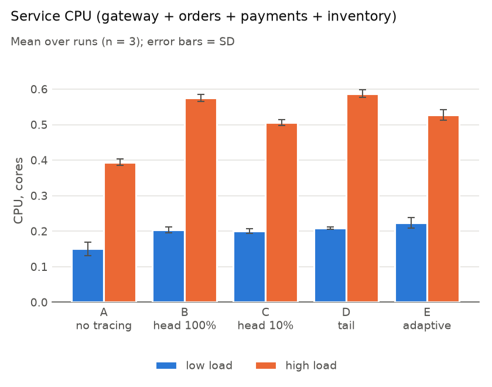
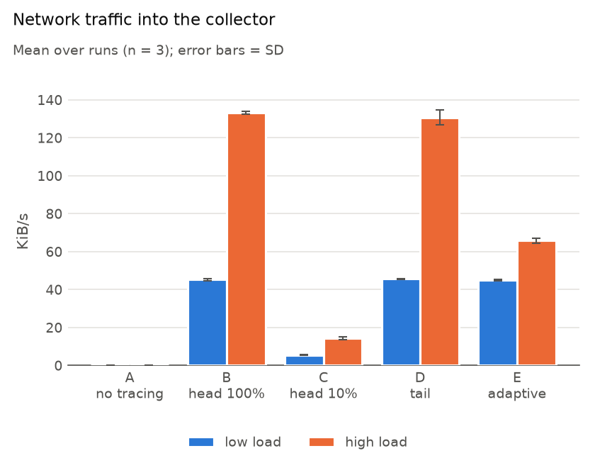
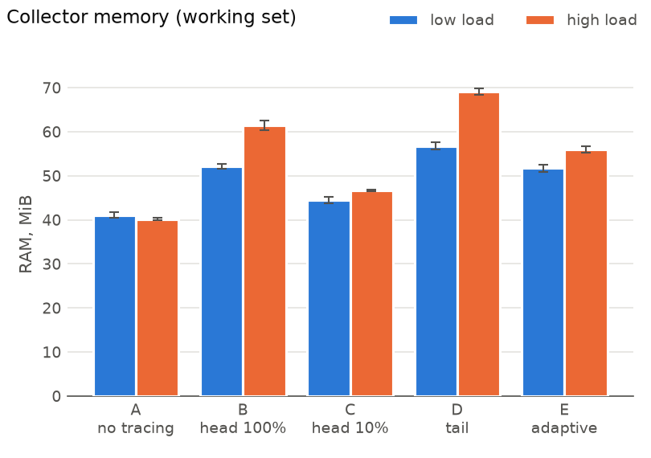
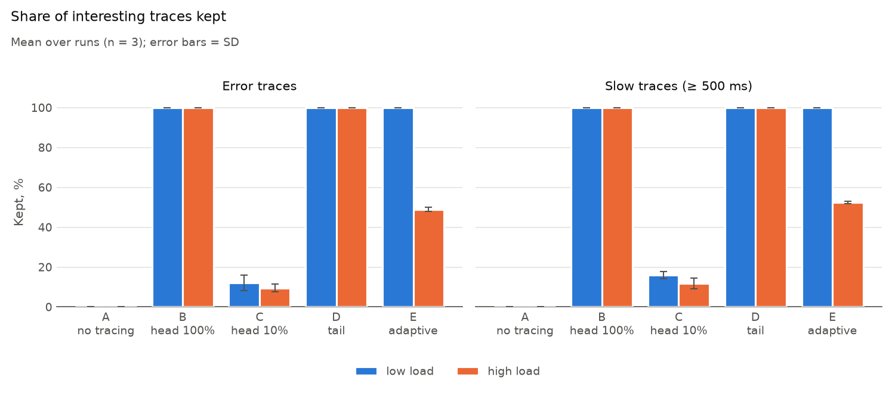
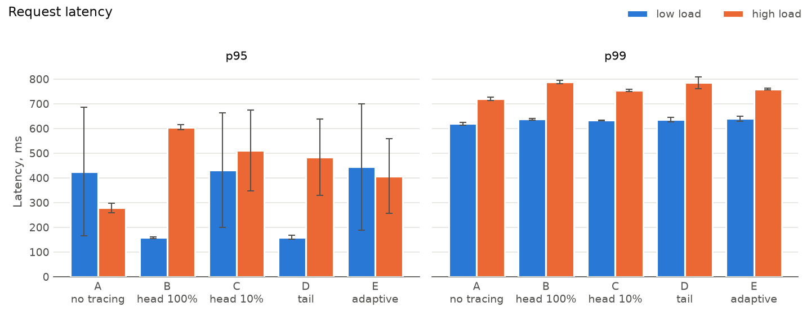

# tracing-tax

Research stand for the coursework *"Optimizing observability systems: the impact
of trace sampling strategies on microservice architecture load"*.

The stand is a small chain of FastAPI services, traced with OpenTelemetry
zero-code instrumentation:

```
                                       ┌──► inventory ──► Redis
curl ──► gateway ──► orders ───────────┤
                                       └──► payments

all services ──OTLP/gRPC──► OTel Collector ──OTLP/gRPC──► Jaeger v2 (UI :16686)

cAdvisor (per-container CPU/RAM/network) ─┐
OTel Collector self-metrics ──────────────┴──► Prometheus (:9090) ──► Grafana (:3000)
```

### What the services mimic

A checkout in an online shop: one request places an order for 1 book and 2 pens.
The logic is deliberately minimal. The services exist to produce a realistic
chain of calls and spans, not real business behaviour.

| Service | In a real shop | Here |
|---|---|---|
| `gateway` | Public entry point (auth, routing) | Forwards the request to `orders` |
| `orders` | Creates the order and coordinates the checkout | 20 ms of "work", then calls `inventory` and `payments`, in that order |
| `inventory` | Reserves stock so two customers can't buy the last item | Adds the quantities to running counters in Redis (`reserved:book`, `reserved:pen`); no stock limits |
| `payments` | Charges the card through a payment provider | Waits 30 ms (the "bank call") and returns a random payment ID |
| `redis` | Inventory database | In-memory counters, no persistence |

### Pinned versions

| Component | Image / package | Version |
|---|---|---|
| Services runtime | `python` | `3.14.10-slim-trixie` |
| Web framework | `fastapi` / `uvicorn` / `httpx` | `0.163.1` / `0.54.0` / `0.28.1` |
| Redis / client | `redis` image / `redis` (redis-py) | `8.10.3-alpine3.23` / `8.1.0` |
| OTel Python SDK / instrumentation | `opentelemetry-sdk` / `opentelemetry-distro` | `1.45.2` / `0.66b2` |
| Collector | `otel/opentelemetry-collector-contrib` | `0.165.0` |
| Tracing backend | `cr.jaegertracing.io/jaegertracing/jaeger` | `2.23.0` |
| Metrics storage | `prom/prometheus` | `v3.16.0` |
| Container metrics | `ghcr.io/google/cadvisor` | `v0.60.6` |
| Dashboards | `grafana/grafana` | `13.3.1` |
| Load generator | `locustio/locust` | `2.47.0` |

Services are a separate uv project (`services/pyproject.toml`). Their full
dependency tree, including transitive packages and hashes, is locked in
`services/uv.lock`, and the image is built with `uv sync --locked`
(uv `0.12.23`, used only at build time).

## Requirements

- Docker with Compose v2
- Python 3.10+ on the host (only for the stdlib verification and experiment scripts)
- [uv](https://docs.astral.sh/uv/) `0.12.x`, for the analysis script (pandas,
  matplotlib) and for local development and IDE support
- Free host ports `8080` (gateway), `16686` (Jaeger UI), `9090` (Prometheus),
  `3000` (Grafana) and `8089` (Locust web UI)
- If your Docker daemon uses a non-default `data-root` (check with
  `docker info --format '{{.DockerRootDir}}'`), put it in a `.env` file so
  cAdvisor can read it, e.g. `DOCKER_DATA_ROOT=/mnt/hdd/docker-data`.

## Run

```bash
docker compose up -d --build
```

The first build takes a minute or two. Wait until `docker compose ps` shows all
services as `healthy`, or use `docker compose up -d --build --wait`.

| UI | URL |
|---|---|
| Jaeger (traces) | <http://localhost:16686> |
| Grafana (resource dashboard) | <http://localhost:3000> |
| Prometheus (raw metrics, targets) | <http://localhost:9090> |

Stop and remove everything with `docker compose down`. Jaeger uses in-memory
storage, so this deletes all traces. Prometheus data is kept in the
`prometheus-data` volume; `docker compose down -v` deletes it too.

## Verify

### Automated

```bash
python3 scripts/verify_trace.py
```

The script sends one request to the gateway and finds its trace through the
Jaeger query API (`/api/v3`). It prints the span tree, checks that every
service-to-service call and every Redis command is linked correctly, and prints a
direct link to the trace in the UI. Expected output (`http send/receive`
INTERNAL spans omitted here):

```
trace fb7324c4...: 19 spans, 4 services

  gateway: GET /order/{order_id}                       SERVER      65.6 ms
    gateway: GET                                       CLIENT      63.8 ms
      orders: GET /orders/{order_id}                   SERVER      61.0 ms
        orders: POST                                   CLIENT       4.1 ms
          inventory: POST /reservations                SERVER       1.6 ms
            inventory: INCRBY                          CLIENT       0.3 ms
            inventory: INCRBY                          CLIENT       0.2 ms
        orders: POST                                   CLIENT      33.7 ms
          payments: POST /payments                     SERVER      31.1 ms

  [PASS] gateway: exactly one SERVER span
  ...
  [PASS] single root span: gateway SERVER
  [PASS] orders SERVER <- gateway CLIENT <- gateway SERVER
  [PASS] inventory SERVER <- orders CLIENT <- orders SERVER
  [PASS] payments SERVER <- orders CLIENT <- orders SERVER
  [PASS] 2 redis CLIENT spans, children of inventory SERVER
  [PASS] every non-root span has its parent inside the trace
```

```bash
python3 scripts/verify_monitoring.py
```

This script checks the metrics pipeline. It sends 50 requests and verifies, via
the Prometheus API, that all scrape targets are up and that cAdvisor reports CPU,
memory and network for every container. It also checks that the collector
accepted, and sent to Jaeger, exactly 50 × 19 spans:

```
  [PASS] scrape target up: cadvisor
  ...
  [PASS] cAdvisor CPU series for all 10 services
  [PASS] cAdvisor memory series for all 10 services
  [PASS] cAdvisor network series for all 10 services
  [PASS] collector network RX > 0 (4649 B/s)
  [PASS] collector accepted 950 spans == 950 expected
  [PASS] collector sent 950 spans to Jaeger == 950 expected
```

Both scripts assume 100% sampling and no other traffic while they run.

### Manual

```bash
curl -i http://localhost:8080/order/42
```

Then open the Jaeger UI at <http://localhost:16686>:

1. **Search** tab → *Service*: `gateway` → *Find Traces*.
2. Open the newest trace `gateway: GET /order/{order_id}`. It shows 4 services and
   19 spans:
   - `gateway  GET /order/{order_id}`: root SERVER span (FastAPI)
     - `gateway  GET`: CLIENT span of the outgoing httpx call
       - `orders  GET /orders/{order_id}`: SERVER span
         - `orders  POST` → `inventory  POST /reservations` → 2 × `INCRBY` (Redis)
         - `orders  POST` → `payments  POST /payments`
   - Each service also adds 2–3 ASGI INTERNAL spans (`http send` / `http receive`).
3. The **Trace Graph** view (top-right dropdown) shows the whole call graph.

Context propagates between services through the W3C `traceparent` header, which
the httpx and FastAPI instrumentations inject and extract automatically.

## Monitoring

Open Grafana at <http://localhost:3000>. The **tracing-tax** dashboard is the
home page and refreshes every 5 s. Anonymous users can view it. Log in as
`admin` / `admin` to edit it or use *Explore*. The dashboard is provisioned from
`monitoring/grafana/dashboards/tracing-tax.json`, so edits made in the UI are
not saved. Change the JSON file instead.

| Row | Panels | Source |
|---|---|---|
| Containers | CPU (100% = one core), memory working set, network RX/TX per compose service | cAdvisor |
| OTel Collector | Network into/out of the collector, spans accepted / refused / sent / failed, exporter queue | cAdvisor + collector self-metrics |

Use the *Service* dropdown to filter the container panels. Useful metrics for
your own queries in Prometheus:

| Metric | Meaning |
|---|---|
| `container_cpu_usage_seconds_total`, `container_memory_working_set_bytes`, `container_network_{receive,transmit}_bytes_total` | per container; filter by `container_label_com_docker_compose_service` |
| `otelcol_receiver_accepted_spans{job="otel-collector"}` | spans the collector received from the services |
| `otelcol_exporter_sent_spans{job="otel-collector"}` | spans successfully written to Jaeger (= stored spans) |

Prometheus scrapes every 5 s. cAdvisor only collects CPU, memory and network
metrics (`--enable_metrics`) with a 5 s housekeeping interval, to keep its own
overhead low.

## Load generation

Locust runs as a container in the same compose file, under the profile `load`,
so `docker compose up` never starts load by itself. Every simulated user sends
one request per second (`load/locustfile.py`), so **users = RPS**.

| Level | Users = RPS | Median latency (scenario B) |
|---|---|---|
| low | 10 | ~120 ms |
| high | 30 | ~240 ms |

The high level is capped at 30 RPS because above that the `orders` service
congests: median latency is 380 ms at 50 RPS, with or without tracing, which
would hide the effect of tracing.

**Headless run** (what the experiment uses), here 2 minutes at the high level:

```bash
docker compose run --rm locust --headless --users 30 --spawn-rate 30 \
    --run-time 2m --csv /mnt/results/load/high --only-summary
```

Results land in `results/load/` (gitignored): `high_stats.csv` has RPS, request
and failure counts and p50/p95/p99 latency. Fault-injected 5xx responses count
as failures.

**Web UI** (interactive, e.g. for the demo):

```bash
docker compose --profile load up -d locust      # open http://localhost:8089
docker compose --profile load stop locust
```

`docker compose run` also starts Locust's dependencies (`gateway` and
everything behind it), and it applies **its own** environment to them. If you
start the stand with e.g. `ORDERS_ERROR_RATE=0.1`, pass the same variables to
`docker compose run`, or Compose will quietly recreate `orders` without them.

## Scenarios

Each experiment scenario is a small env file in `scenarios/`. Switching between
them needs no code changes and no rebuild.

| Scenario | File | Sampler | Measures |
|---|---|---|---|
| A | `scenarios/A.env` | none: SDK disabled, no instrumentation, no export | baseline cost of the services alone |
| B | `scenarios/B.env` | `always_on` | head-based 100%: full tracing overhead |
| C | `scenarios/C.env` | `parentbased_traceidratio`, `0.1` | head-based 10%: overhead when ~90% of traces are dropped at the source |
| D | `scenarios/D.env` | `always_on` + collector `tail_sampling` (`COLLECTOR_CONFIG=tail`) | tail-based: services still export 100%, the collector keeps errors, slow traces (> 500 ms) and 10% of the rest; costs collector memory for buffering |
| E | `scenarios/E.env` | `adaptive`, `15` (cap, traces/s) | adaptive head-based: keeps every trace below the cap, ~15 traces/s above it (see [Adaptive sampler](#adaptive-sampler-scenario-e)) |

Start (or switch to) a scenario:

```bash
docker compose --env-file .env --env-file scenarios/C.env up -d --wait
```

`--env-file` **replaces** the default `.env` instead of adding to it, so pass
`.env` first if you have one (e.g. for `DOCKER_DATA_ROOT`). The later file wins.
Leave out `--env-file .env` if you have no `.env`. Variables exported in your
shell override both files. Compose recreates only the containers whose settings
changed, which are the four services. Jaeger keeps its stored traces across the switch.

Pass the same flags when you generate load. Otherwise `docker compose run`
recreates the services with the defaults (see [Load generation](#load-generation)):

```bash
docker compose --env-file .env --env-file scenarios/C.env run --rm locust \
    --headless --users 30 --spawn-rate 30 --run-time 2m --csv /mnt/results/load/C_high --only-summary
```

Without a scenario file, the stack runs with the compose defaults
(`parentbased_always_on`), which behave like B.

**Why A sets three variables.** `OTEL_SDK_DISABLED=true` alone only replaces
the tracers with no-op ones: `opentelemetry-instrument` would still patch
FastAPI, httpx and redis, and set up the exporter. A also sets
`OTEL_PYTHON_DISABLED_INSTRUMENTATIONS=*` (skip all instrumentations) and
`OTEL_TRACES_EXPORTER=none`, so the baseline carries as little tracing
machinery as possible without a different image.

**Verify a scenario:**

```bash
python3 scripts/verify_sampling.py scenarios/C.env
```

The script reads the expected ratio from the file (A: 0, B: 1, C: 0.1, D: 0.1,
E: 1) and sends 500 requests. It then compares how many spans the collector stored in Jaeger
(the Prometheus counter delta, so traces from earlier scenarios don't count)
with the expected share. The result must be within 3σ of a binomial, and every
trace must be complete (a multiple of 19 spans, because ParentBased keeps or drops a trace
as a whole):

```
scenario C: expected ratio 0.1
...
1007 spans stored = 53 traces of 500 requests (ratio 0.106)

  [PASS] whole traces only (1007 spans is a multiple of 19)
  [PASS] ratio 0.106 within 0.1 ± 0.040
```

For D (tail sampling) the script also checks that the collector *accepted*
every span (500 x 19: the services still export 100%). It runs without
`scenarios/faults.env`, so only the 10% probabilistic policy keeps traces:

```
scenario D: expected ratio 0.1 (tail sampling)
...
1121 spans stored = 59 traces of 500 requests (ratio 0.118)

  [PASS] whole traces only (1121 spans is a multiple of 19)
  [PASS] ratio 0.118 within 0.1 ± 0.040
  [PASS] services exported every span (9500 accepted = 9500)
```

For E the script expects every trace: it sends requests one at a time
(at most ~10/s), which is below the cap. That the cap holds at high load is
checked by the experiment itself (`traces_kept / requests` ≈ 0.5 at 30 RPS).

## Experiment

`scripts/run_experiment.py` runs every scenario at both load levels, three
times, and writes one CSV row per run to `results/raw/runs.csv`. It needs only
Docker and the host Python (stdlib only).

```bash
# Pilot: 2 scenarios, 1 load level, 1 repetition (~8 min)
python3 scripts/run_experiment.py --scenarios A,B --levels high --reps 1 --out results/raw/pilot.csv

# Full experiment: all scenarios/[A-Z].env x low, high x 3 repetitions
python3 scripts/run_experiment.py
```

Each run:

1. **Restart.** Recreates the measured containers (the four services, Redis, the
   collector and Jaeger), so every run starts with fresh processes, empty
   Jaeger storage and zeroed collector counters. Prometheus, cAdvisor and
   Grafana keep running.
2. **Load.** One Locust run: a 30 s warm-up (cold processes, connection pools,
   the first span batches; discarded), then 2 min measured.
3. **Drain.** Waits 20 s, so the last spans reach Jaeger and the last metrics
   reach Prometheus. With tail sampling (D) the collector holds every trace for
   `decision_wait` (10 s) before it exports it, so D waits 25 s and reads
   `spans_stored` 10 s later than the other scenarios.
4. **Collect.** Reads the Locust request log, Prometheus and Jaeger, then appends
   the row to the CSV.

Runs are interleaved (repetition 1 of every scenario and level, then repetition 2,
and so on), so slow drift of the host affects all scenarios alike. Runs that are already
in the CSV are skipped, so after a crash or `Ctrl+C` run the same command again
and it continues where it stopped. One run takes about 3.5 minutes, so A–D
(24 runs) take about 1 h 25 min and A–E (30 runs) about 1 h 45 min. See `--help` for
the other options (`--warmup`, `--duration`, `--drain`, `--no-build`, ...).

**Host.** Keep the machine otherwise idle during the experiment. On a laptop,
keep it on AC power: on battery the CPU runs slower, which in a test run
raised service CPU by ~20% and p50 latency by ~80 ms. A run measured under
different host conditions is not comparable; delete its row from the CSV and
run the same command again to repeat it.

**Faults.** Every compose call gets `.env` (if present), `scenarios/faults.env`
and the scenario file, so fault injection is identical in all scenarios:
`payments` fails 5% of requests and delays another, independent 5% by 500 ms.
Without faults there would be nothing to measure in the error/slow retention columns.

**Counting kept traces.** Locust sends every request with a unique order ID and
logs it (`results/raw/locust/<run_id>.json`, gitignored). The runner looks up
each request from the measured window in Jaeger by that ID (it is part of the
root span's URL). Error and slow are decided once, from what the client saw:
an error is a failed response (5xx), and slow means at least 500 ms. So
"kept" never exceeds "sent". Requests started in the last 5 s of the window
are not counted, because they may still be in flight when Locust stops.

| Columns | Source | Meaning |
|---|---|---|
| `run_id`, `scenario`, `level`, `users`, `rep`, `started_at`, `warmup_s`, `duration_s` | runner | run identity and settings |
| `measure_start`, `measure_end` | Locust | measured window (Unix time) |
| `requests`, `rps`, `p50_ms`, `p95_ms`, `p99_ms` | Locust log | requests in the window, their rate and exact latency percentiles |
| `errors_sent`, `slow_sent` | Locust log | failed / slow (≥ 500 ms) requests among them |
| `cpu_<container>`, `cpu_services` | cAdvisor | mean CPU in cores over the window; `services` = sum of the four services |
| `mem_<container>_mb`, `mem_services_mb` | cAdvisor | mean memory working set, MiB |
| `collector_rx_bytes` | cAdvisor | bytes received by the collector container in the window |
| `spans_accepted`, `spans_stored` | collector | spans received from the services / written to Jaeger |
| `traces_kept`, `errors_kept`, `slow_kept` | Jaeger | sent requests whose trace is in Jaeger |
| `errors_kept_share`, `slow_kept_share` | derived | `errors_kept / errors_sent`, `slow_kept / slow_sent` |

Containers are `gateway`, `orders`, `payments`, `inventory`, `redis`, `collector`
and `jaeger`.

## Analysis

`analysis/analyze.py` turns the experiment CSV into the summary table and
charts for the report. It needs uv (pandas and matplotlib are pinned in the
root `pyproject.toml`).

```bash
uv run analysis/analyze.py                          # results/raw/runs.csv
uv run analysis/analyze.py results/raw/pilot.csv    # any CSV(s) from the runner
```

Several CSVs are merged (run IDs must not repeat). Every metric is aggregated
per scenario and load level as mean ± sample SD over the repetitions; with a
single repetition only the mean is shown. Output goes to `results/analysis/`
(`--out` to change it) and is overwritten on every run:

| File | Content |
|---|---|
| `summary.md` | one Markdown table for the report (RPS, latency, CPU, RAM, network, spans, kept shares) |
| `summary.csv` | the same numbers in long form: `scenario, level, metric, mean, sd, n` |
| `cpu_services.png` | CPU of the four services, cores |
| `latency.png` | p95 and p99 latency, ms |
| `collector_network.png` | traffic into the collector, KiB/s (`collector_rx_bytes / duration_s`) |
| `collector_memory.png` | collector working set, MiB |
| `traces_kept.png` | share of error and slow traces kept, % |

All charts are grouped bars: one group per scenario, one bar per load level,
error bars = SD.

## Results

The final dataset is `results/raw/runs.csv`: 5 scenarios × 2 load levels × 3
repetitions = 30 runs, 30 s warm-up + 120 s measured each, faults as in
`scenarios/faults.env` (5% errors, 5% slow). The table and charts in
`results/analysis/` were produced from it with `uv run analysis/analyze.py`.

Host: Intel Core i7-7700HQ (4 cores / 8 threads), 16 GB RAM, Fedora 44
(kernel 7.3), Docker 29.10.0, Compose 5.8.0, on AC power. Every measured
container is limited to 1 CPU and 512 MiB.

### Key numbers at high load (30 RPS)

Mean ± SD over 3 runs. The full table for both load levels is in
[`results/analysis/summary.md`](results/analysis/summary.md).

| Scenario | CPU services, cores | p50, ms | Net to collector, KiB/s | Spans stored/s | RAM collector, MiB | Errors kept, % | Slow kept, % |
|---|---:|---:|---:|---:|---:|---:|---:|
| A: no tracing | 0.394 ± 0.009 | 174 ± 2 | 0.1 | 0 | 40.2 ± 0.3 | – | – |
| B: head 100% | 0.575 ± 0.010 | 232 ± 10 | 133.2 ± 0.8 | 545 ± 10 | 61.4 ± 1.1 | 100 | 100 |
| C: head 10% | 0.506 ± 0.008 | 209 ± 9 | 14.3 ± 0.7 | 56 ± 4 | 46.7 ± 0.2 | 9.5 ± 2.0 | 11.8 ± 2.6 |
| D: tail | 0.587 ± 0.011 | 236 ± 17 | 130.8 ± 3.8 | 100 ± 4 | 69.2 ± 0.7 | 100 | 100 |
| E: adaptive (cap 15/s) | 0.528 ± 0.015 | 211 ± 9 | 65.8 ± 1.4 | 269 ± 9 | 56.0 ± 0.7 | 48.9 ± 1.1 | 52.4 ± 0.7 |







### What the numbers show

- **Full tracing has a clear cost.** B vs A at 30 RPS: service CPU +46%
  (+0.18 cores, ≈ 6 ms of CPU per request of 19 spans), median latency +33%
  (174 → 232 ms), service RAM +25% (218 → 273 MiB), ~133 KiB/s of extra
  traffic. At 10 RPS: CPU +34%, p50 +22%.
- **Head sampling cuts traffic and storage in proportion, CPU only partly.**
  C (10%) sends 89% less to the collector and stores 90% fewer spans, but
  removes only 38% of the CPU overhead (0.18 → 0.11 cores). The rest, about
  4 ms of CPU per request, is spent by the instrumentation on every request
  whether the trace is sampled or not: FastAPI/httpx/redis wrappers, context
  and `traceparent` propagation, non-recording spans. Only recording and
  exporting (~0.14 ms of CPU per stored span here) scale with the sampling
  rate. Service RAM does not depend on the sampling rate at all (the SDK and
  instrumentation are loaded anyway).
- **Head sampling drops interesting traces blindly.** C keeps 9–12% of error
  traces and 12–16% of slow ones, the same share as of all traces.
- **Tail sampling keeps them, but the services pay the full price.** D keeps
  100% of error and slow traces and stores 82% fewer spans than B, yet the
  services' CPU (0.587 vs 0.575 cores) and the traffic into the collector
  (131 vs 133 KiB/s) are the same as with 100% tracing, because the services
  still export every span. The collector pays for buffering: +13% RAM at high
  load (61 → 69 MiB), +9% at low load.
- **Adaptive sampling bounds the volume.** E keeps every trace at 10 RPS
  (below the cap, CPU and traffic like B) and ~14 traces/s at 30 RPS (cap
  15), halving traffic and storage. Its CPU (0.528) is where the
  fixed + per-span model predicts for a 50% rate (≈ 0.536). Like any head
  sampler it decides before the outcome is known, so it keeps errors at the
  same ~50% rate as everything else.
- **Collector CPU is negligible** at this load (≤ 0.007 cores in every
  scenario); its cost shows up in memory and network.
- At low load the CPU differences between the tracing scenarios (0.20–0.22
  cores) are within about 2 SD of each other and are not meaningful.

### Conclusion on the hypothesis

The hypothesis is **confirmed**, with one refinement:

1. *Head-based sampling reduces overhead on the services but blindly drops
   error traces.* Confirmed. It reduces the export part of the overhead
   (network, collector load, storage) in proportion to the sampling rate,
   but CPU on the services only partly (38% of the overhead at 10%
   sampling), because the instrumentation cost per request is paid for
   every request. It keeps about the same share of error and slow traces as
   of all traces.
2. *Tail-based sampling keeps error/slow traces but does not reduce export
   overhead or network traffic from the services, and costs collector
   memory.* Confirmed: 100% of error and slow traces kept, service CPU and
   network equal to 100% tracing, collector RAM +13%.
3. Adaptive head sampling sits in between: it adapts the rate to the load
   and caps storage and network, but is as blind to errors as fixed-rate
   head sampling.

Practical takeaway: head or adaptive sampling when the goal is lower cost and
statistical visibility; tail sampling when every error must be kept and the
collector can be given the memory; in production the two are often combined
(an adaptive head sampler to bound volume, tail sampling to keep the
interesting traces).

### Limitations

- One host, 3 repetitions per setting, two load levels. Differences of a few
  percent (e.g. between the tracing scenarios at low load) are within noise.
- The services are synthetic and their spans are small (standard HTTP/Redis
  attributes, no events). With larger spans the per-span cost, and so the
  CPU saved by sampling, would be larger.
- p95 is not reliable here: the 5% slow fault (+500 ms) sits right at the
  95th percentile, so p95 jumps between ~160 and ~600 ms from run to run (SD
  up to ±260 ms). Use p50 and p99 for latency.
- RAM is the cAdvisor working set, which also counts recently read files.
  In one run a cold start of the collector binary added ~165 MiB of page
  cache; that run was repeated. A repeat run on battery power gave ~20%
  higher CPU and was repeated on AC power as well.

## Demo (defense)

About 5 minutes: run load, switch C → D → E without rebuilding, and show the
effect in Grafana and Jaeger. Leave out `--env-file .env` if you have no
`.env`.

```bash
ENV="--env-file .env --env-file scenarios/faults.env"

# 1. Head 10% (C), with Locust web UI
docker compose $ENV --env-file scenarios/C.env --profile load up -d --build --wait
```

1. Open Locust at <http://localhost:8089>, start **30 users, spawn rate 30**.
2. Grafana <http://localhost:3000>: *Collector spans* (~55 spans/s sent) and
   *Network into collector / s* (~14 KiB/s).
3. Jaeger <http://localhost:16686>: service `gateway`, *Tags* `error=true`,
   lookback *Last 5 minutes*. Only a few error traces: about 90% were dropped
   at the source.
4. Switch to tail sampling (D). Compose recreates the services and the
   collector, and Locust keeps running (a few failed requests during the
   restart are expected):

   ```bash
   docker compose $ENV --env-file scenarios/D.env --profile load up -d --wait
   ```

   Grafana: network into the collector and *Spans accepted / s* jump to the
   100% level (~130 KiB/s, ~550 spans/s), while only ~100 spans/s are sent to
   Jaeger; collector memory grows. Jaeger: every error trace is there (also
   try *Min Duration* `500ms` for the slow ones).
5. Switch to adaptive (E):

   ```bash
   docker compose $ENV --env-file scenarios/E.env --profile load up -d --wait
   ```

   At 30 users ~270 spans/s (~14 traces/s, the cap is 15) reach Jaeger. In
   Locust, change the number of users to 10: now every trace is kept
   (~180 spans/s).
6. Stop: `docker compose --profile load down`.

## Configuration

All knobs are environment variables read by `docker-compose.yml`. Pass them on the
command line, e.g. `ORDERS_ERROR_RATE=0.1 docker compose up -d`, or put them in a
`.env` file (which git ignores).

### Sampling (standard OTel SDK env vars)

Normally set through a scenario file (see [Scenarios](#scenarios)).

| Variable | Default | Examples |
|---|---|---|
| `OTEL_TRACES_SAMPLER` | `parentbased_always_on` | `always_on`, `always_off`, `parentbased_traceidratio`, `adaptive` |
| `OTEL_TRACES_SAMPLER_ARG` | `1.0` | `0.1`, `0.01` (ratio for `*traceidratio`), `15` (cap in traces/s for `adaptive`) |
| `OTEL_SDK_DISABLED` | `false` | `true` (scenario A) |
| `OTEL_PYTHON_DISABLED_INSTRUMENTATIONS` | empty | `*` (scenario A), `redis` |
| `OTEL_TRACES_EXPORTER` | `otlp` | `none` (scenario A) |

`scripts/verify_trace.py` and `scripts/verify_monitoring.py` assume 100% sampling (B).

### Adaptive sampler (scenario E)

The only sampling code in the repo, `services/adaptive_sampler/`, is a small
package installed into the services' image. It registers `adaptive` in the
SDK's `opentelemetry_traces_sampler` entry point group, so it is selected like
a built-in sampler, through `OTEL_TRACES_SAMPLER` / `OTEL_TRACES_SAMPLER_ARG`.

- The gateway counts new traces in tumbling 5 s windows. At the end of each
  window it sets the keep probability for the next one to
  `min(1, cap / rate)`, where `rate` is the measured traces/s.
- Below the cap every trace is kept. Above it about `cap` traces/s are kept.
  The first window, and the window after an idle gap, keep everything.
- Whether a trace is kept is decided from its trace ID, the same way as
  `TraceIdRatioBased`. The sampler is wrapped in `ParentBased`, so the
  downstream services follow the gateway's decision and traces stay whole.
- It lags traffic changes by one window (5 s); the 30 s warm-up covers that.

Unit tests of the rate logic (stdlib `unittest`, fake clock):

```bash
cd services && uv run python -m unittest discover -s adaptive_sampler/tests -v
```

### Fault injection

Each service has its own variables, prefixed with its name (`GATEWAY_`, `ORDERS_`,
`INVENTORY_`, `PAYMENTS_`):

| Variable | Default | Meaning |
|---|---|---|
| `<SERVICE>_ERROR_RATE` | `0` | Probability (0..1) of answering HTTP 500 |
| `<SERVICE>_SLOW_RATE` | `0` | Probability (0..1) of adding extra delay |
| `ORDERS_WORK_MS` | `20` | Simulated work in `orders` |
| `PAYMENTS_WORK_MS` | `30` | Simulated payment provider call in `payments` |

Inside the containers these map to `ERROR_RATE`, `SLOW_RATE`, `SLOW_DELAY_MS`
(default 500) and `WORK_MS` (see `services/common/faults.py`). The experiment
sets them through `scenarios/faults.env` (see [Experiment](#experiment)).

A failure anywhere downstream propagates up: the failing service answers `500`,
and every caller above it answers `502` (`services/common/downstream.py`). All
server spans on that path get status `ERROR`. A slow request only adds latency
and does not change the span status.

### Collector config

`COLLECTOR_CONFIG` selects `collector/configs/<name>.yaml` (default: `passthrough`).
Each scenario file sets it:

| Config | Used by | Pipeline |
|---|---|---|
| `passthrough` | A, B, C, E | `otlp` -> `batch` -> Jaeger: forwards every span it receives |
| `tail` | D | `otlp` -> `tail_sampling` -> `batch` -> Jaeger |

`tail.yaml` buffers each trace for `decision_wait: 10s` (more than the SDK's
5 s batch delay plus the longest trace), then keeps it if **any** policy
matches:

- `errors`: `status_code` `ERROR` on any span;
- `slow`: trace duration (earliest start to latest end) above 500 ms, the same
  threshold as `SLOW_DELAY_MS` and the runner's `--slow-threshold-ms`;
- `baseline`: 10% `probabilistic` by trace ID.

Decision caches keep late spans with their trace's decision. The collector
also exposes `otelcol_processor_tail_sampling_*` metrics (decisions per policy,
late spans, traces dropped too early) on its Prometheus endpoint.

## Repository layout

```
services/
  Dockerfile           # one image for all services, selected via SERVICE build arg
  pyproject.toml       # uv project for the services: direct deps, pinned
  uv.lock              # full locked dependency tree (used by the image build)
  common/faults.py     # ERROR_RATE / SLOW_RATE fault injection
  common/downstream.py # HTTP calls to other services, failures -> 502
  gateway/app.py       # GET /order/{id} -> orders
  orders/app.py        # GET /orders/{id} -> inventory, payments
  inventory/app.py     # POST /reservations, INCRBY per item in Redis
  payments/app.py      # POST /payments, simulated work
  adaptive_sampler/    # scenario E sampler package (+ unit tests)
collector/configs/     # one OTel Collector config per scenario
jaeger/config.yaml     # Jaeger v2 config (OTLP in, in-memory storage, UI)
monitoring/
  prometheus.yml       # scrape targets: cAdvisor, collector
  grafana/provisioning/  # Prometheus datasource + dashboard provider
  grafana/dashboards/    # tracing-tax.json dashboard
scripts/verify_trace.py       # end-to-end trace check
scripts/verify_monitoring.py  # metrics pipeline check
scripts/verify_sampling.py    # scenario sampling ratio check
scripts/run_experiment.py     # scenarios x load levels x repetitions -> CSV
analysis/analyze.py    # CSV -> summary table and charts (uv run)
scenarios/             # one env file per experiment scenario (A-E)
scenarios/faults.env   # fault injection shared by all experiment runs
load/locustfile.py     # steady load: 1 request/s per user, per-request log
results/raw/runs.csv   # final dataset (30 runs), see Results
results/raw/           # experiment CSVs (raw/locust/ = per-run request logs, gitignored)
results/analysis/      # summary table and charts from analysis/analyze.py
results/load/          # ad-hoc Locust runs (gitignored)
docker-compose.yml
pyproject.toml         # uv project (non-package) for host-side tooling
```

## Notes

- Services run under `opentelemetry-instrument uvicorn app:app` with one worker
  and no `--reload`. Both of those options break zero-code instrumentation.
- Instrumentation packages are pinned explicitly in `services/pyproject.toml` rather than
  installed with `opentelemetry-bootstrap -a install`, which resolves versions at
  build time.
- Only traces are exported (`OTEL_METRICS_EXPORTER=none`, `OTEL_LOGS_EXPORTER=none`),
  so measured overhead comes from tracing alone. `/health` is excluded from tracing.
- All services, Redis and the collector share the same limits (`cpus: 1.0`,
  `mem_limit: 512m`), defined once in `docker-compose.yml`. Monitoring containers
  have their own, separate limits.
- Jaeger's self-tracing is disabled (`OTEL_TRACES_SAMPLER=always_off` on the
  Jaeger container). Otherwise every query to the Jaeger API would store extra
  `jaeger` spans next to the services' traces.
- The compose project name is fixed (`name: tracing-tax`), so metric labels don't
  depend on the directory the repo is cloned into.
- When reading span counters after traffic, wait about 10 s: the Python SDK
  exports spans every 5 s (`OTEL_BSP_SCHEDULE_DELAY`) and Prometheus scrapes every
  5 s. Right after restarting the whole stack, Prometheus may still return the
  previous run's last counter value for a few minutes. Use only recent samples,
  e.g. `last_over_time(...[10s])`, as `scripts/verify_monitoring.py` does.
- Redis runs purely in memory (no RDB/AOF persistence), so disk I/O doesn't add
  noise to the measurements.
- Service healthchecks use a bash `/dev/tcp` probe instead of starting Python.
  Healthchecks run inside the measured containers, so their CPU counts against
  the services: a Python probe cost ~350 ms CPU, about 7% of a core at a 5 s
  interval, while the bash probe costs ~4 ms. Probes run every second during
  startup, then every 30 s.
- The `inventory` health check does not ping Redis. Excluding `/health` from
  tracing only drops the HTTP span, so a Redis `PING` would still create a
  standalone trace on every probe.
- Service dependencies and host tooling are separate uv projects with separate
  locks, so upgrading analysis or load tools can never change what runs inside
  the measured services.

## Development (IDE setup)

There are two independent Python environments:

| Environment | Created by | Used for |
|---|---|---|
| `services/.venv` | `cd services && uv sync` | service code, same versions as in the containers |
| `.venv` (root) | `uv sync` | host-side tooling (load, experiments, analysis) |

**PyCharm**: open the repo root as the project, then:

1. *Settings → Project → Python Interpreter*: set the root `.venv`.
2. *File → Open…* `services/` and choose **Attach** to add it to the current
   window as a second module. Set its interpreter to `services/.venv`
   (*Add Interpreter → Existing → services/.venv/bin/python*).
3. Right-click `services/common` and choose *Mark Directory as → Sources Root*,
   so that `from faults import ...` and `import downstream` resolve. In the image, `common/` and the
   service folder are copied into the same directory.

**VS Code**: select `services/.venv/bin/python` as the interpreter when you
work on the services, and add `"python.analysis.extraPaths": ["services/common"]`
to `.vscode/settings.json`.

**Updating dependencies** (then rebuild with `docker compose build`):

```bash
cd services
uv add 'fastapi==<new version>'             # change a direct dependency
uv lock --upgrade-package grpcio            # bump one transitive dependency
uv sync                                     # refresh the local services/.venv
```

The image build fails if `uv.lock` is out of date with `pyproject.toml`.
