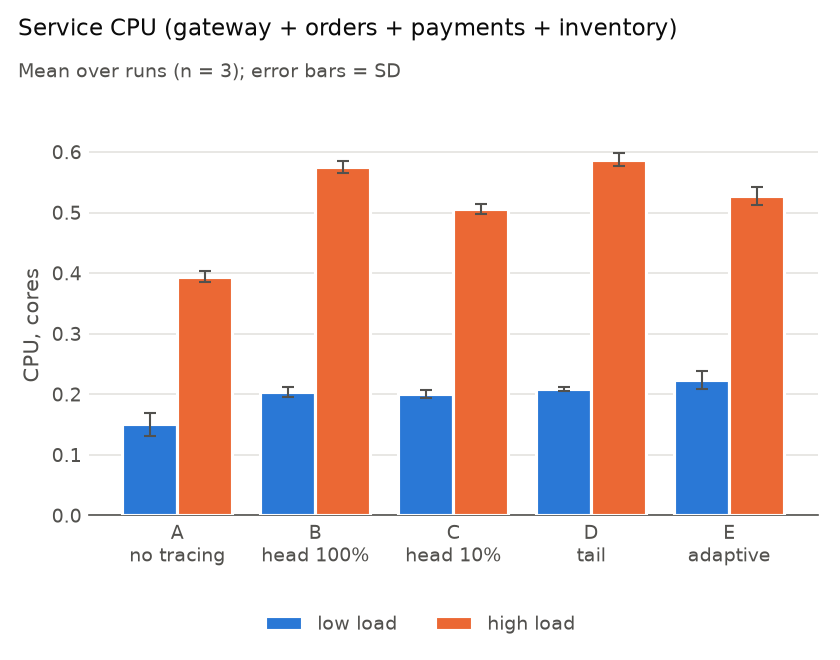
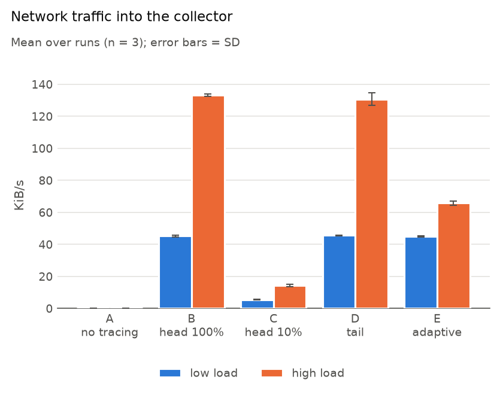
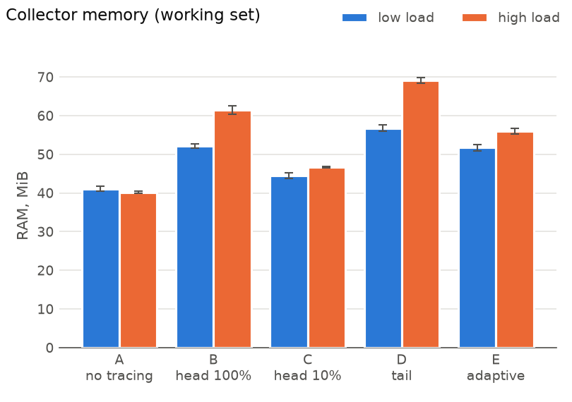
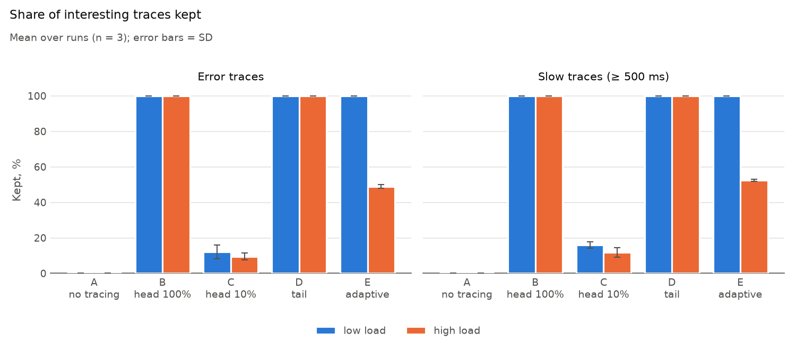
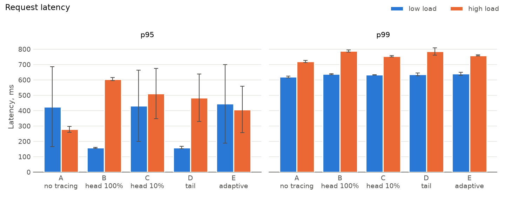

# Results

The final dataset is `results/raw/runs.csv`: 5 scenarios × 2 load levels × 3
repetitions = 30 runs, 30 s warm-up + 120 s measured each, faults as in
`scenarios/faults.env` (5% errors, 5% slow). The table and charts in
`results/analysis/` were produced from it with `uv run analysis/analyze.py`.

Host: Intel Core i7-7700HQ (4 cores / 8 threads), 16 GB RAM, Fedora 44
(kernel 7.3), Docker 29.10.0, Compose 5.8.0, on AC power. Every measured
container is limited to 1 CPU and 512 MiB.

## Key numbers at high load (30 RPS)

Mean ± SD over 3 runs. The full table for both load levels is in
[`results/analysis/summary.md`](../results/analysis/summary.md).

| Scenario | CPU services, cores | p50, ms | Net to collector, KiB/s | Spans stored/s | RAM collector, MiB | Errors kept, % | Slow kept, % |
|---|---:|---:|---:|---:|---:|---:|---:|
| A: no tracing | 0.394 ± 0.009 | 174 ± 2 | 0.1 | 0 | 40.2 ± 0.3 | – | – |
| B: head 100% | 0.575 ± 0.010 | 232 ± 10 | 133.2 ± 0.8 | 545 ± 10 | 61.4 ± 1.1 | 100 | 100 |
| C: head 10% | 0.506 ± 0.008 | 209 ± 9 | 14.3 ± 0.7 | 56 ± 4 | 46.7 ± 0.2 | 9.5 ± 2.0 | 11.8 ± 2.6 |
| D: tail | 0.587 ± 0.011 | 236 ± 17 | 130.8 ± 3.8 | 100 ± 4 | 69.2 ± 0.7 | 100 | 100 |
| E: adaptive (cap 15/s) | 0.528 ± 0.015 | 211 ± 9 | 65.8 ± 1.4 | 269 ± 9 | 56.0 ± 0.7 | 48.9 ± 1.1 | 52.4 ± 0.7 |

## What the numbers show

- **Full tracing has a clear cost.** B vs A at 30 RPS: service CPU +46%
  (+0.18 cores, ≈ 6 ms of CPU per request of 19 spans), median latency +33%
  (174 → 232 ms), service RAM +25% (218 → 273 MiB), ~133 KiB/s of extra
  traffic. At 10 RPS: CPU +34%, p50 +22%.
- **Head sampling cuts traffic and storage in proportion, CPU only partly.**
  C (10%) sends 89% less to the collector and stores 90% fewer spans, but
  removes only 38% of the CPU overhead (0.18 → 0.11 cores). The rest, about
  4 ms of CPU per request, is spent by the instrumentation on every request
  whether the trace is sampled or not: FastAPI/httpx/redis wrappers, context
  and `traceparent` propagation, non-recording spans. Only recording and
  exporting (~0.14 ms of CPU per stored span here) scale with the sampling
  rate. Service RAM does not depend on the sampling rate at all (the SDK and
  instrumentation are loaded anyway).
- **Head sampling drops interesting traces blindly.** C keeps 9–12% of error
  traces and 12–16% of slow ones, the same share as of all traces.
- **Tail sampling keeps them, but the services pay the full price.** D keeps
  100% of error and slow traces and stores 82% fewer spans than B, yet the
  services' CPU (0.587 vs 0.575 cores) and the traffic into the collector
  (131 vs 133 KiB/s) are the same as with 100% tracing, because the services
  still export every span. The collector pays for buffering: +13% RAM at high
  load (61 → 69 MiB), +9% at low load.
- **Adaptive sampling bounds the volume.** E keeps every trace at 10 RPS
  (below the cap, CPU and traffic like B) and ~14 traces/s at 30 RPS (cap
  15), halving traffic and storage. Its CPU (0.528) is where the
  fixed + per-span model predicts for a 50% rate (≈ 0.536). Like any head
  sampler it decides before the outcome is known, so it keeps errors at the
  same ~50% rate as everything else.
- **Collector CPU is negligible** at this load (≤ 0.007 cores in every
  scenario); its cost shows up in memory and network.
- At low load the CPU differences between the tracing scenarios (0.20–0.22
  cores) are within about 2 SD of each other and are not meaningful.

## Conclusion on the hypothesis

The hypothesis is **confirmed**, with one refinement:

1. *Head-based sampling reduces overhead on the services but blindly drops
   error traces.* Confirmed. It reduces the export part of the overhead
   (network, collector load, storage) in proportion to the sampling rate,
   but CPU on the services only partly (38% of the overhead at 10%
   sampling), because the instrumentation cost per request is paid for
   every request. It keeps about the same share of error and slow traces as
   of all traces.
2. *Tail-based sampling keeps error/slow traces but does not reduce export
   overhead or network traffic from the services, and costs collector
   memory.* Confirmed: 100% of error and slow traces kept, service CPU and
   network equal to 100% tracing, collector RAM +13%.
3. Adaptive head sampling sits in between: it adapts the rate to the load
   and caps storage and network, but is as blind to errors as fixed-rate
   head sampling.

Practical takeaway: head or adaptive sampling when the goal is lower cost and
statistical visibility; tail sampling when every error must be kept and the
collector can be given the memory; in production the two are often combined
(an adaptive head sampler to bound volume, tail sampling to keep the
interesting traces).

## Limitations

- One host, 3 repetitions per setting, two load levels. Differences of a few
  percent (e.g. between the tracing scenarios at low load) are within noise.
- The services are synthetic and their spans are small (standard HTTP/Redis
  attributes, no events). With larger spans the per-span cost, and so the
  CPU saved by sampling, would be larger.
- p95 is not reliable here: the 5% slow fault (+500 ms) sits right at the
  95th percentile, so p95 jumps between ~160 and ~600 ms from run to run (SD
  up to ±260 ms). Use p50 and p99 for latency.
- RAM is the cAdvisor working set, which also counts recently read files.
  In one run a cold start of the collector binary added ~165 MiB of page
  cache; that run was repeated. A repeat run on battery power gave ~20%
  higher CPU and was repeated on AC power as well.
